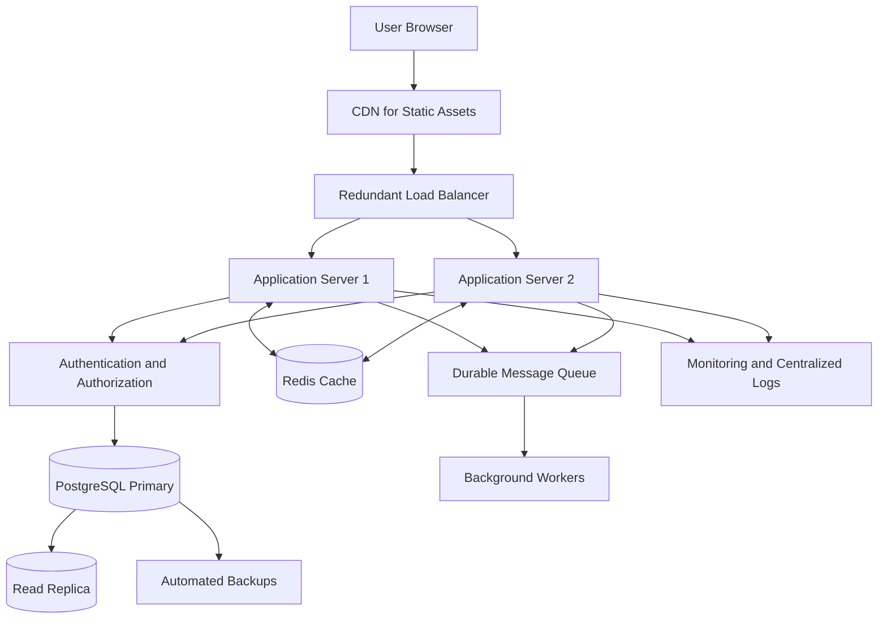

# QuickNotes System Architecture

## 1. Overview

QuickNotes is a note-taking application that allows users to create, view, update, delete, search, and organize notes using tags.

The frontend currently demonstrates API operations using JavaScript and JSONPlaceholder, a mock REST API. This document describes a proposed production architecture for supporting up to one million registered users. JSONPlaceholder does not provide the complete production backend described here.

## 2. Architecture Requirements

### Functional requirements
- Users can create and manage notes.
- Users can organize notes using tags.
- Users can retrieve, search, and filter their notes.
- The API validates requests and returns consistent responses.
- Users can access only their own private notes.

### Non-functional requirements
- Scalability as users and requests increase.
- Reliable data storage, backup, and recovery.
- Secure authentication and authorization.
- Responsive API performance under normal and peak traffic.
- Maintainability through separated frontend, backend, and database responsibilities.

## 3. High-Level Architecture

The following diagram shows the proposed production architecture.

The primary request path is:

**Browser → CDN and load balancer → Application servers → PostgreSQL database.**

Supporting services include Redis for selected cached data, a message queue and background workers for non-critical tasks, monitoring and centralized logging, and automated database backups.

### Component responsibilities

**1. Client application**

The browser renders the interface and sends HTTP requests. JavaScript handles asynchronous operations, displays loading and error messages, and updates the interface when requests complete.

**2. CDN**

A content delivery network serves static assets such as CSS, JavaScript, and images from locations closer to users. Private note data must not be publicly cached.

**3. Load balancer**

The load balancer distributes requests across multiple application servers and routes traffic away from unhealthy instances. Redundant load-balancing infrastructure reduces the risk of a single point of failure.

**4. Application servers**

Backend servers authenticate users, validate input, enforce note ownership, implement business rules, and communicate with the database. Stateless application instances can be added horizontally as demand grows.

**5. PostgreSQL database**

PostgreSQL stores users, notes, tags, and note-tag relationships. Primary keys, foreign keys, unique constraints, and transactions protect data integrity.

**6. Redis cache**

Redis can cache carefully selected, frequently accessed results. Cache invalidation is required after updates. PostgreSQL remains the authoritative source for stored notes, and the application should fall back safely if Redis is unavailable.

**7. Message queue and background workers**

Workers handle non-critical tasks such as notifications and exports. Jobs should use bounded retries, idempotency, and a dead-letter mechanism for repeatedly failing tasks.

**8. Monitoring and backups**

Monitoring collects request latency, error rates, CPU and memory use, database connection counts, and queue depth. Automated backups and tested restoration procedures support disaster recovery.

## 4. Traffic Estimates for One Million Registered Users

These are planning assumptions, not measured production traffic.

Assumptions:
- Registered users: 1,000,000.
- Daily active users: 10% of registered users = 100,000.
- Average API requests per active user per day: 10.
- Read requests: 90% of all requests.
- Write requests: 10% of all requests.
- Peak traffic multiplier: 10 times the daily average.

### Daily request volume

100,000 active users × 10 requests = 1,000,000 API requests per day.

Average requests per second:

1,000,000 ÷ 86,400 ≈ 11.6 requests per second.

Estimated peak rate:

11.6 × 10 ≈ 116 requests per second.

### Read and write estimates

| Metric | Daily requests | Average requests/second |
|---|---:|---:|
| Read requests (90%) | 900,000 | 10.42 |
| Write requests (10%) | 100,000 | 1.16 |
| Total | 1,000,000 | 11.57 |

At the assumed tenfold peak, the system may experience approximately 104 read requests and 12 write requests per second.

These are API request counts, not database query counts. One API request can execute multiple SQL queries. Real capacity should be established through load testing and monitoring.

## 5. Request Flows

### 5.1 Reading notes

1. The user opens the notes page.
2. The frontend sends an authenticated `GET /api/v1/notes` request.
3. The load balancer forwards the request to a healthy application server.
4. The server verifies the user's identity and checks access permissions.
5. The server retrieves the user's notes from PostgreSQL or uses a valid cache entry where appropriate.
6. The API returns JSON with pagination metadata.
7. The frontend renders the notes and displays an appropriate status message.

If the request fails, the frontend displays a useful error message and allows the user to retry.

### 5.2 Creating a note

1. The user enters a title and note body.
2. The frontend validates required fields and sends a `POST /api/v1/notes` request.
3. The server authenticates the user and validates the payload.
4. The server starts a database transaction.
5. PostgreSQL inserts the note using the authenticated user's ID.
6. If tags are supplied, the server validates them and creates note-tag relationships in the same transaction.
7. The transaction commits after all required operations succeed; otherwise, it rolls back.
8. The server returns HTTP `201 Created` with the new note.
9. The frontend displays the new note and a success message.

### 5.3 Updating a note

1. The frontend sends an authenticated `PATCH /api/v1/notes/{noteId}` request.
2. The server validates the payload and verifies the user's identity.
3. The database update filters by both the note ID and authenticated user ID.
4. If the note belongs to the user, the update succeeds; otherwise, the API returns an appropriate error without exposing another user's private data.
5. The server commits the transaction and invalidates or updates relevant cache entries.
6. The API returns the updated note and the frontend refreshes the displayed content.

### 5.4 Deleting a note

1. The frontend sends an authenticated `DELETE /api/v1/notes/{noteId}` request.
2. The server verifies the user's identity.
3. The delete operation filters by both the note ID and authenticated user ID.
4. Related note-tag rows are removed through appropriate foreign-key rules or an explicit transaction.
5. The server commits the operation and invalidates relevant cache entries.
6. The API returns a success response, and the frontend removes the note from the display.

A user must not be able to read, update, or delete another user's note by changing a note ID.

## 6. Database Design and Performance

The production data model uses four relational tables:

- `users`: account information.
- `notes`: note content and ownership.
- `tags`: reusable tag names.
- `note_tags`: the many-to-many relationship between notes and tags.

### Indexing

Recommended indexes include:
- Unique index on `users.email`.
- Index on `notes(user_id, updated_at DESC)` for listing a user's latest notes.
- Composite primary key on `note_tags(note_id, tag_id)`.
- Additional index on `note_tags(tag_id, note_id)` for finding notes by tag.

Indexes should be reviewed against actual query plans. Excessive indexes consume storage and slow down inserts and updates.

### Pagination

The API should return a limited number of notes per request. Cursor-based pagination is useful for large datasets because it avoids increasingly expensive offset scans. Use a stable sort order and an indexed cursor field.

### Transactions

Creating a note and its tag relationships should use a database transaction so partial changes are not left behind if an operation fails.

## 6.1 Annual Storage Capacity Estimates

These estimates use explicit planning assumptions. Actual storage depends on note length, metadata, indexes, attachments, deletion rates, and user activity.

### Assumptions

- Registered users: 1,000,000.
- Daily active users: 100,000.
- Average notes created per active user per day: 2.
- Average stored note content and basic metadata: 2 KB per note.
- Days per year: 365.
- Note creation remains constant throughout the year.
- The projection assumes no deletion of notes.

### Annual note creation

100,000 active users × 2 notes per day = 200,000 new notes per day.

200,000 notes/day × 365 days = 73,000,000 new notes per year.

### Annual content storage

73,000,000 notes × 2 KB = 146,000,000 KB per year.

Using decimal units, that is approximately 146 GB of new note data per year before indexes, transaction logs, backups, replicas, and other operational overhead.

### Three-year projection

| Period | New notes in period | Cumulative notes | Approximate cumulative raw storage |
|---|---:|---:|---:|
| Year 1 | 73 million | 73 million | 146 GB |
| Year 2 | 73 million | 146 million | 292 GB |
| Year 3 | 73 million | 219 million | 438 GB |

For preliminary planning, allow roughly 1.5–2 times the raw data estimate for primary database storage to accommodate indexes and overhead. This is an initial allowance, not a guaranteed capacity figure. Calculate backup and replica storage separately according to the retention and replication design.

### Storage management

Monitor database size, index growth, write volume, and backup duration. Establish retention policies where appropriate, test restoration procedures, and review capacity forecasts regularly. If attachments are introduced, store them in object storage rather than directly in the relational database where practical.

## 7. Scalability Strategy

### Application layer

Run multiple stateless application instances behind the load balancer. Add instances when monitoring shows sustained increases in traffic or resource usage. Health checks and capacity limits help prevent overloaded instances from receiving new requests.

### Database layer

Begin with a properly indexed PostgreSQL primary database and connection pooling. Add read replicas for read-heavy workloads when appropriate, while accounting for replication lag.

Writes should be directed to the authoritative primary database. If the workload eventually exceeds a single database's capacity, evaluate partitioning or sharding using measured evidence.

### Caching

Cache static content and carefully selected read-heavy data. Invalidate or update cache entries after writes. Cache keys for private data must include the appropriate user scope, and private responses must not be shared across users.

### Asynchronous processing

Move non-critical operations to a durable queue. Use retry limits, idempotent jobs, monitoring, and a dead-letter mechanism for repeatedly failing tasks. Queue depth and processing delay should trigger alerts before backlogs become severe.

### Peak traffic protection

Use rate limits, request timeouts, bounded database connection pools, and load shedding to protect the service during spikes. A token-bucket rate limiter can cap the rate of requests admitted to the application tier while allowing a controlled burst. Requests rejected due to limits should receive HTTP `429 Too Many Requests` and, where useful, a `Retry-After` header.

## 8. Single Points of Failure and Mitigation

| Potential failure | Impact | Mitigation |
|---|---|---|
| Single application server | API becomes unavailable if the server fails | Multiple instances, health checks, and automated replacement |
| Single load balancer | Requests cannot reach healthy servers if it fails | Redundant load-balancing infrastructure and health monitoring |
| Primary database failure | Reads and writes may become unavailable | Replication, tested failover, automated recovery, and backups |
| Cache outage | Slower requests or temporary loss of cached results | Treat cache as optional and fall back safely to PostgreSQL |
| Queue or worker failure | Background tasks are delayed | Durable queues, retries, dead-letter handling, and queue monitoring |
| Network or cloud-region outage | Users may lose access to services | Recovery plans, tested backups, and a secondary-region strategy where justified |
| Database connection exhaustion | Requests queue or fail | Connection pooling, bounded pools, query timeouts, and alerts |
| Credential compromise | Unauthorized access to notes | Strong authentication, authorization, secret management, rotation, and audit logging |
| Bad deployment or migration | Errors, data loss, or service interruption | Automated tests, staged deployment, backward-compatible migrations, and rollback plans |

Redundancy reduces individual points of failure but does not guarantee uninterrupted service.

The team should define and test:
- **Recovery Time Objective (RTO):** how quickly service should be restored.
- **Recovery Point Objective (RPO):** how much recent data loss is acceptable.

Backups should be isolated from ordinary application credentials, and restoration should be tested regularly. Database failover must also be designed to avoid split-brain writes.

## 9. Security and Reliability

- Use HTTPS for all production traffic.
- Hash passwords using a suitable password-hashing algorithm.
- Authenticate requests and authorize access to every private note.
- Use parameterized SQL queries.
- Validate request bodies and limit payload sizes.
- Apply rate limiting to reduce abuse.
- Keep secrets outside source code.
- Avoid logging passwords, access tokens, or private note content.
- Monitor failures and suspicious activity.
- Test database backup restoration regularly.
- Use least-privilege permissions for application and operational accounts.
- Apply security updates and review dependencies regularly.

## 10. Trade-offs

### PostgreSQL versus NoSQL

PostgreSQL provides relational integrity, joins, and transactions, making it suitable for notes and tags. A NoSQL database might offer different scaling characteristics but would introduce different data consistency and relationship-management considerations. PostgreSQL is the simpler initial choice because note ownership and tag relationships benefit from relational constraints.

### Cache versus database reads

Caching reduces repeated database work and can improve response times. However, invalidation introduces complexity and can cause stale results. PostgreSQL remains authoritative, and cache failure must not cause data loss or expose private data.

### Synchronous versus asynchronous operations

Synchronous requests are appropriate for actions where the user needs an immediate result, such as saving a note. Queues are better for non-critical background work, but introduce eventual completion, retries, duplicate-delivery handling, and operational monitoring.

### Replication versus sharding

Read replicas can improve read capacity but may return slightly stale data. Sharding can distribute large workloads but increases operational complexity, cross-shard query difficulty, and rebalancing work. Both should be introduced only when actual performance data justifies them.

### Strong consistency versus availability during failure

A single authoritative PostgreSQL primary simplifies writes and transactional consistency. During primary failure, writes may need to pause until failover is complete. Automated failover can reduce downtime, but must be designed to prevent split-brain writes and should be tested.

### Cost versus redundancy

Multiple application instances, replicas, backups, and a secondary region improve resilience but increase cost and operational effort. The initial deployment should prioritize tested backups, monitoring, and application redundancy, then add more expensive multi-region capabilities according to business recovery requirements.

## 11. Conclusion

The proposed QuickNotes architecture separates the browser, API services, database, cache, and background processing. It supports growth through horizontal application scaling, efficient SQL queries, caching, and optional database replication.

The traffic and storage figures are explicit planning assumptions rather than measured production results. They should be validated with realistic load tests, query monitoring, and storage measurements before production deployment. Security, note ownership, transaction integrity, monitoring, and recovery procedures remain essential at every scale.
